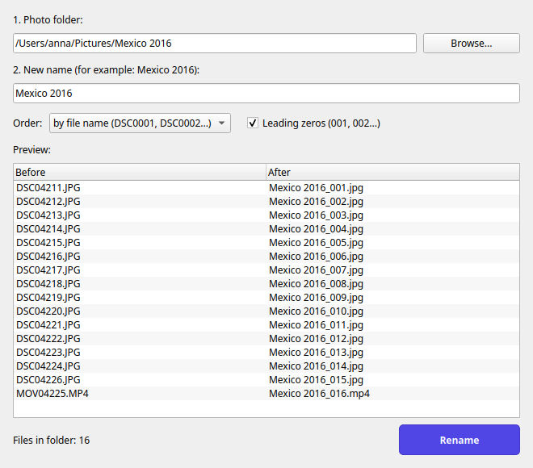

<div align="center">


# Photo Batch Renamer

**Rename every photo in a folder in one click: `DSC0001.JPG` → `Mexico 2016_1.jpg`**

Free desktop app for Windows, macOS and Linux. No Python or anything else to install.

[](https://github.com/kalatyn/photo-batch-renamer/actions/workflows/build.yml)
[](https://github.com/kalatyn/photo-batch-renamer/releases/latest)
[](LICENSE)


**English** · [Русский](README.ru.md)



</div>

## Why

You come back from a trip with 500 photos called `DSC0001.JPG`, `DSC0002.JPG`, `IMG_4711.HEIC`…
Copy them into a folder, open Photo Batch Renamer, type `Mexico 2016` and every file gets a clear,
numbered name: `Mexico 2016_1.jpg`, `Mexico 2016_2.jpg`, `Mexico 2016_3.mp4`.

## Features

- **Live preview.** See “before → after” for every file before anything changes.
- **Sort by date taken.** Uses the capture date stored in the photo (EXIF) for JPEG and TIFF, the file date for everything else. Handy when one folder mixes a camera and a phone.
- **Undo.** Changed your mind? One click restores the original names.
- **Safe.** Never overwrites a file. If something fails halfway, every name is put back.
- **Leading zeros (optional).** `001, 002, …` so files sort correctly everywhere.
- **Keeps file types.** Photos, videos and RAW files (`.cr2`, `.nef`, `.arw`, …) keep their extension.
- **Drag and drop.** Drop a folder onto the window.
- **Skips system files** such as `Thumbs.db`, `desktop.ini`, `.DS_Store` and hidden files.
- **Same app everywhere.** Identical window on Windows, macOS and Linux.

## Download

Get the latest version from the **[Releases page](https://github.com/kalatyn/photo-batch-renamer/releases/latest)**:

| System | File |
|---|---|
| Windows 10 / 11 | `PhotoBatchRenamer-…-Windows-Setup.exe` |
| macOS, Apple Silicon (M1 and newer) | `PhotoBatchRenamer-…-macOS-arm64.dmg` |
| macOS, Intel | `PhotoBatchRenamer-…-macOS-intel.dmg` |
| Ubuntu, Debian, Linux Mint | `photo-batch-renamer_…_amd64.deb` |
| Other Linux (portable) | `PhotoBatchRenamer-…-Linux-x86_64.tar.gz` |

Not sure which Mac you have? Apple menu → **About This Mac**: “Apple M…” means Apple Silicon, “Intel” means Intel.

## Install

The app is free and not signed with a paid developer certificate, so Windows and macOS show a warning
the first time. This is expected.

<details>
<summary><b>Windows</b></summary>

1. Run `PhotoBatchRenamer-…-Windows-Setup.exe`.
2. If you see **“Windows protected your PC”**, click **More info → Run anyway**.
3. Follow the installer. No administrator rights needed.

The app appears in the Start menu (and on the desktop if you chose so).
Uninstall it like any other app: **Settings → Apps**.
</details>

<details>
<summary><b>macOS</b></summary>

1. Open the `.dmg` and drag **Photo Batch Renamer** into **Applications**.
2. Open the app. macOS says it cannot verify the developer. Click **Done** (or **OK**).
3. Open **System Settings → Privacy & Security**, scroll down and click **Open Anyway** next to Photo Batch Renamer.

You only need to do this once.
</details>

<details>
<summary><b>Linux (Ubuntu, Debian, Mint)</b></summary>

Double-click the `.deb` file to install it, or run:

```bash
sudo apt install ./photo-batch-renamer_*_amd64.deb
```

The app appears in your applications menu. Needed system libraries are installed automatically.

**Other distributions:** unpack the `.tar.gz` and run `PhotoBatchRenamer/Photo Batch Renamer`.
</details>

## How to use

1. Click **Browse…** and choose the folder with your photos (or drop the folder onto the window).
2. Type the new name, for example `Mexico 2016`. The folder name is filled in for you.
3. Choose the order: **by file name** (the order your camera took them) or **by date taken**.
4. Check the preview and click **Rename**.

> [!IMPORTANT]
> The app renames **all files** in the chosen folder (not in subfolders). Put only the photos you want to rename into it.

## FAQ

**Does it change my photos?**
No. Only file names change. Image data, EXIF and file dates stay as they are.

**Can I undo?**
Yes, with the **Undo** button, until you close the app. After that, the original names are gone.

**What does “by date taken” use?**
The capture date from EXIF for JPEG and TIFF files. For other files (HEIC, RAW, videos) it uses the file’s modification date, which cameras and copy tools normally keep.

**Why is the download so large (about 50 MB)?**
The installer contains everything the app needs, so you don’t have to install Python or other software.

## Build from source

Requires Python 3.10+.

```bash
git clone https://github.com/kalatyn/photo-batch-renamer.git
cd photo-batch-renamer
python -m venv .venv && source .venv/bin/activate   # Windows: .venv\Scripts\activate
pip install -r requirements-build.txt

python -m pytest                                      # run the tests
PYTHONPATH=src python -m photo_batch_renamer          # start the app
python packaging/build.py                             # build the installer for your system
```

`packaging/build.py` creates a `.exe` installer on Windows (needs [Inno Setup 6](https://jrsoftware.org/isinfo.php)),
a `.dmg` on macOS, and a `.deb` plus `.tar.gz` on Linux, all in `dist/`.

Releases are built automatically by [GitHub Actions](.github/workflows/build.yml):
pushing a tag such as `v1.0.1` builds all installers and publishes them on the Releases page.

### Project layout

```
src/photo_batch_renamer/
  core.py      rename logic (no GUI, fully tested)
  app.py       main window (Qt / PySide6)
  i18n.py      all interface texts
tests/         pytest tests for core.py
packaging/     build script, PyInstaller spec, Windows installer, Linux package files
assets/        app icon (png, ico, icns)
```

## Contributing

Bug reports and ideas are welcome in [Issues](https://github.com/kalatyn/photo-batch-renamer/issues).
Pull requests too: please run `python -m pytest` before sending one.

## License

[MIT](LICENSE). Free for personal and commercial use.
